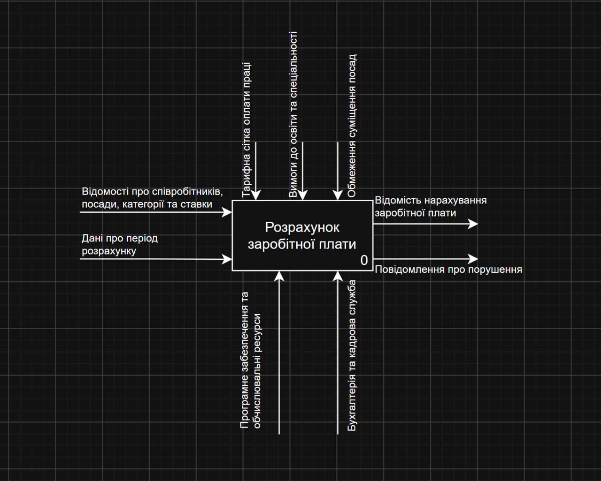

# Практична робота №3

**Тема:** CASE-засоби моделювання бізнес-процесів ІС, методологія IDEF0.

**Предметна область:** Варіант 1 — «Зарплата 1».

## Мета роботи

Набути досвіду створення IDEF0-моделі бізнес-процесів за допомогою CASE-засобів.

## Опис роботи

У середовищі draw.io було побудовано контекстну діаграму IDEF0 для процесу розрахунку заробітної плати.

Основна функція системи — «Розрахунок заробітної плати».

Діаграма містить:
- **Input:** відомості про співробітників, посади, категорії та ставки; дані про період розрахунку.
- **Control:** тарифна сітка, вимоги до освіти та спеціальності, обмеження суміщення посад.
- **Output:** відомість нарахування заробітної плати та повідомлення про порушення.
- **Mechanism:** програмне забезпечення та обчислювальні ресурси, бухгалтерія та кадрова служба.

## Контекстна діаграма IDEF0

## Висновок

У результаті роботи було побудовано контекстну діаграму IDEF0 для предметної області «Зарплата 1» та визначено основні елементи процесу розрахунку заробітної плати.
